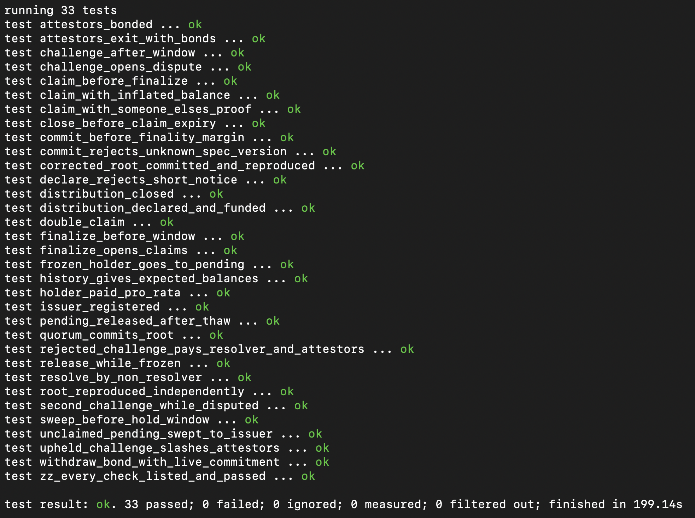
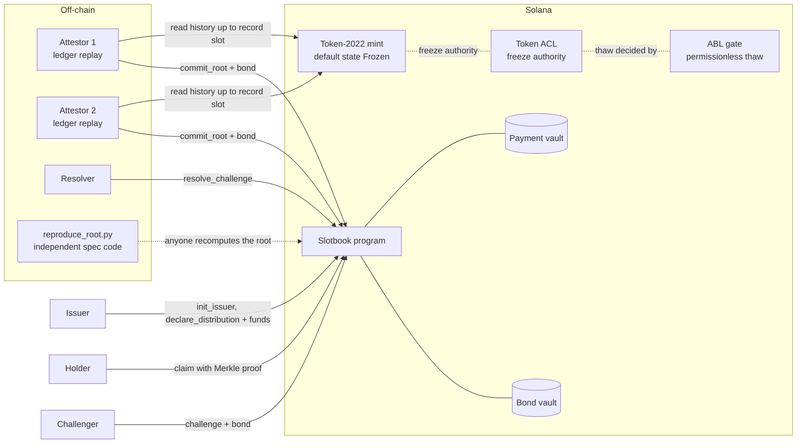
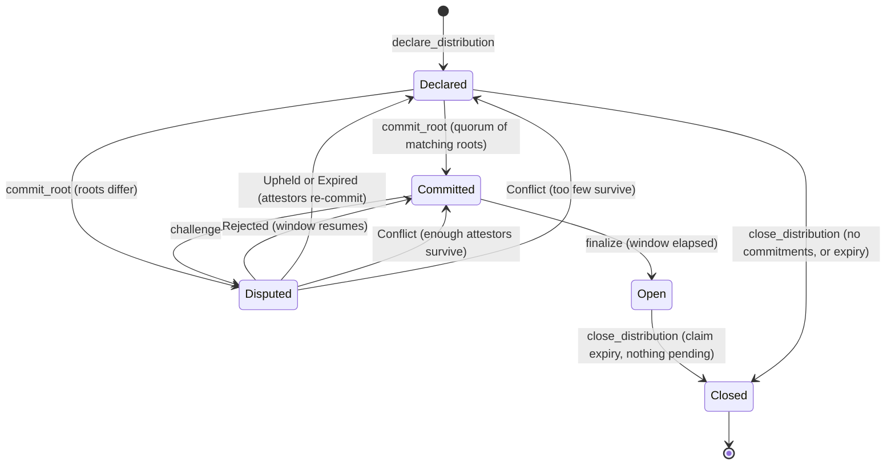

# Slotbook

A verifiable, disputable record-date holder register for permissioned SPL tokens on Solana.

When a tokenized fund or bond pays a coupon or dividend, the money goes to whoever held
the token on the **record date**. On Solana that is a **record slot**. Slotbook turns
"who held mint M at slot S, and how much?" into a Merkle root that is:

- **committed** by bonded attestors, each rebuilding the register from the ledger on their own;
- **challengeable** by anyone during a window, with a resolver who recomputes the disputed owner;
- **paid out** on-chain, pro rata, against Merkle proofs, while respecting the token's freeze rules.

## Devnet

| | |
|---|---|
| **Program ID** | [`3ZaUF1Q6FH9HaD7kjMNVztaFtJxQY9U3Zk7CuR3wAqJp`](https://explorer.solana.com/address/3ZaUF1Q6FH9HaD7kjMNVztaFtJxQY9U3Zk7CuR3wAqJp?cluster=devnet) |
| Cluster | devnet |
| Toolchain | Anchor 1.1.2, Agave 3.1.10, Rust 1.89.0 (pinned by `rust-toolchain.toml`) |
| Token ACL (freeze authority of the permissioned mint) | `TACLkU6CiCdkQN2MjoyDkVg2yAH9zkxiHDsiztQ52TP` |
| ABL gate (permissionless thaw) | `GATEzzqxhJnsWF6vHRsgtixxSB8PaQdcqGEVTEHWiULz` |

## Tests

### On devnet

33 tests run the whole lifecycle once against the deployed program on devnet, then check
every step: 17 state checks (distribution state, roots, exact payouts, bond and fee
movements, Pending amounts, closed accounts) and 15 refusals the program must make with
the expected error (double claim, bad or borrowed proof, early commit, finalize, sweep or
close, challenge after the window, resolve by a non-resolver, and more), plus one test
that every check ran and passed.

    cargo test -p demo --test devnet -- --ignored --test-threads=1



The run's transaction log, with an explorer link for every transaction, is written to
`target/devnet-test/DEMO_RUN.md`. Details: [crates/demo/README.md](crates/demo/README.md).

### Local (LiteSVM, runs in CI)

    anchor build
    cargo test --workspace --locked

49 tests across the workspace:

| Suite | What it covers |
|---|---|
| `programs/slotbook/tests/happy_path.rs` | declare, commit, finalize, claim |
| `programs/slotbook/tests/full_lifecycle.rs` | the full demo flow, plus the `Conflict` and `Expired` ruling paths |
| `programs/slotbook/tests/guards.rs` | 10 attack and edge cases: permanent-delegate mints, pre-created vaults and Pending addresses, late commits, challenges after the window, double-binding in `resolve_challenge`, `register_total` challenges, release to a non-owner, close then `update_issuer` |
| `programs/slotbook/tests/program_smoke.rs` | the program loads and the IDL has the full interface |
| `crates/snapshot/tests/spec_vectors.rs` | the Rust code matches test vectors from an independent Python implementation of the spec |
| `crates/merkle`, `crates/snapshot`, `crates/attestor` | tree and proof unit tests; ledger replay on a LiteSVM harness |

## Architecture

### Components



1. The **issuer** links a permissioned Token-2022 mint (freeze authority: Token ACL) with
   `init_issuer`, then declares a distribution: record slot, total, payment token. The total
   is funded into a vault owned by the distribution.
2. After the record slot plus a finality margin, each **attestor** rebuilds the register
   (owner → balance, summed per owner) from the ledger and commits its Merkle root. Once a
   quorum of matching roots is in, the distribution is `Committed`.
3. During the challenge window **anyone** can post a bonded challenge naming an owner and
   the balance they think is right. The **resolver** recomputes that owner and rules.
4. After the window, `finalize` opens claims. Each **holder** claims with a Merkle proof and
   is paid `floor(total * balance / register_total)`. If the holder's token account is
   frozen, the payout goes into a `Pending` account. It is released once the account is
   thawed, or swept back to the issuer after a hold window.

The register, salt, leaf, tree, proof and manifest are defined byte for byte in
[docs/SNAPSHOT_SPEC.md](docs/SNAPSHOT_SPEC.md). Two attestors working independently
produce the same root, and anyone can check it against the published test vectors.

### Distribution state machine



### Rulings and bonds

| Ruling | Who calls it | Effect |
|---|---|---|
| `Upheld` | resolver | Attestors who backed the challenged root are slashed (fee to the resolver, rest to the challenger) and their commitments closed. The challenger's bond is returned. Back to `Declared`. |
| `Rejected` | resolver | The challenger's bond pays the resolver fee; the rest goes to the attestors who backed the root. The window resumes. |
| `Conflict { root }` | resolver | Attestors whose root differs from the named one are slashed to the issuer. |
| `Expired` | anyone, after the resolve timeout | Commitments closed, challenger's bond returned. Back to `Declared`. |

### Accounts (PDAs)

| Account | Seeds | Lifetime |
|---|---|---|
| `IssuerConfig` | `["issuer", mint]` | Never closed. Owns the bond vault. |
| `Attestor` | `["attestor", issuer_config, attestor]` | Closed by `withdraw_bond`. |
| `Distribution` | `["distribution", issuer_config, id_u64_le]` | Never closed; `Closed` is terminal. Owns the payment vault. |
| `Commitment` | `["commitment", distribution, attestor]` | Closed at resolution or by `release_attestor`. |
| `Challenge` | `["challenge", distribution, index_u32_le]` | Closed at resolution; rent back to the challenger. |
| `ClaimReceipt` | `["claim", distribution, owner]` | Never closed; blocks a second claim. |
| `Pending` | `["pending", distribution, owner]` | A frozen holder's payout. Closed by `release_pending` or `sweep_pending`. |

### Instructions (14)

| Role | Instructions |
|---|---|
| Issuer | `init_issuer`, `update_issuer`, `declare_distribution`, `sweep_pending`, `close_distribution` |
| Attestor | `register_attestor`, `commit_root`, `release_attestor`, `withdraw_bond` |
| Disputes | `challenge`, `resolve_challenge` |
| Payout | `finalize`, `claim`, `release_pending` |

### Leaf and tree

```
salt = keccak("slotbook-salt-v1" || distribution || owner || seed)
leaf = keccak(0x00 || keccak(owner || balance_u64_le || salt))
```

Pairs are sorted before hashing and an odd node is promoted, so a proof is only the list
of siblings, bottom-up, at most 32. `claim` verifies it on-chain.

## Repository layout

| Path | What |
|---|---|
| `programs/slotbook` | The Anchor program and its LiteSVM tests |
| `crates/merkle` | Leaf hashing, sorted-pair tree, proofs (shared by the program and off-chain code) |
| `crates/snapshot` | Holder register and manifest, per the spec |
| `crates/attestor` | Ledger replay over RPC to a record slot: `attestor replay --mint <M> --slot <S> --rpc-url <URL>` |
| `crates/demo` | `slotbook-demo`: the whole lifecycle on a live cluster, with an explorer link for every transaction |
| `scripts/issuer` | Issuer setup: Token-2022 mint under Token ACL and the ABL gate |
| `scripts/reproduce_root.py` | Recomputes a root from a register with the independent Python spec code |
| `docs/` | [Snapshot spec](docs/SNAPSHOT_SPEC.md), [test vectors](docs/vectors), [issuer runbook](docs/ISSUER_RUNBOOK.md), [demo guide](docs/DEMO.md) |

## Running the demo

The demo creates its own permissioned mint, holders, attestors, resolver and challengers,
then runs the whole lifecycle: commit, reproduce the root, a rejected challenge, an upheld
challenge with slashing and a corrected root, claims (paid directly; frozen then released;
frozen then swept), close, and attestor exit.

    cargo run -p demo -- --rpc-url https://api.devnet.solana.com --out demo-out-devnet

It needs an issuer keypair with at least 2 SOL and writes `DEMO_RUN.md` with an explorer
link for every transaction. For a local validator run, see [crates/demo/README.md](crates/demo/README.md).

## Known limitations (v1)

- Every holder is in the register, including the issuer's own treasury and program-owned
  accounts; there is no exclusion list (spec section 3.8).
- The demo pays and bonds in test USDC mints it creates, not Circle's devnet USDC.
- The demo thaws with Token ACL's authority thaw; in production the ABL gate's permissionless thaw does it.
- In the demo one operator runs both attestors and the resolver.

## Team

- **Mahelika**: snapshot spec, on-chain program
- **Olaoluwa** ([ApostleOfFinance](https://github.com/ApostleOfFinance)): attestor and ledger replay
- **Kwesi** ([chikwesi](https://github.com/chikwesi)): issuer scripts, devnet setup, docs
